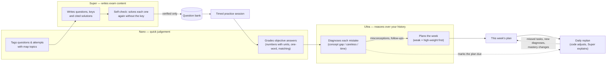

# CourseMate AI

**Study and exam prep built on your own course material — with an exam agent that plans your week.**
Create a **course**, split it into **units**, and add what your lecturer gave you: PDFs, slides, Word
docs, photos of handwritten notes, scanned PDFs, lecture recordings, links, the syllabus and past
papers. CourseMate answers questions with citations to the exact page, slide or minute, and turns the
material into flashcards, quizzes, graded answer writing and timed practice. For JEE, NEET, GATE, UPSC
and university exams, an **exam agent** builds a knowledge map of the syllabus, writes self-checked
practice questions in the exam's own format and marking, diagnoses why each answer went wrong, and
plans your study week — replanning every day from your results.

It runs on any OpenAI-compatible AI provider (OpenAI, Hugging Face, Groq, OpenRouter, Gemini…) or
entirely on local models (Ollama, LM Studio), and answers in English or 11 Indian languages.

| Layer     | Tech |
|-----------|------|
| Frontend  | React 19 + Vite + Tailwind CSS v4 (`frontend/`), KaTeX for maths |
| Backend   | Node.js 20+ + Express (`backend/`) |
| Database  | PostgreSQL 13+ via `pg` — schema created automatically on start (`backend/src/db/schema.sql`) |
| Auth      | Email + verified code + password (scrypt) and/or Google OAuth; sessions in Postgres |
| AI        | LangChain `ChatOpenAI` / `OpenAIEmbeddings` against any OpenAI-compatible API (embeddings can also use Hugging Face feature extraction); ffmpeg for recordings |

## Contents

- [Features](#features)
- [How the exam agent works](#how-the-exam-agent-works)
- [Quick start](#quick-start)
- [5-minute demo](#5-minute-demo)
- [AI providers and settings](#ai-providers-and-settings)
- [npm scripts](#npm-scripts)
- [API](#api)
- [How it works (details)](#how-it-works-details)
- [Deploying to production](#deploying-to-production)

## Features

**Your material**
- **Courses with units** — group sources into units; a scope selector limits chat to chosen units.
  Sources are *notes*, the *syllabus* or *past papers* (CourseMate suggests which after an upload).
- **Cited chat** — answers cite the source with its page (*p. 12*), slide (*Slide 4*) or recording
  timestamp (*12:34*); the source viewer opens at that spot. Maths renders with KaTeX.
- **Photos, scans and lectures** — a vision model reads handwritten notes and scanned PDFs; lecture
  audio/video is transcribed with timestamps (ffmpeg + any `/audio/transcriptions` API).
- **Shared courses** — invite classmates as editors (change the material) or viewers (read, chat,
  practise). Chat, progress, practice, exams and plans stay personal.

**Study and practice**
- **Flashcards** with SM-2 spaced repetition, generated from chosen units, each card citing its page.
- **Quizzes and answer writing** — MCQ quizzes and 2/5/10-mark written answers graded against your
  sources; **explain it back** checks your own explanation of a topic.
- **Topics and mastery** — topics per unit, mastery from every answer, "revise these today".
- **Past-paper insights** — questions extracted from past papers, mapped to topics, ranked by how
  often and for how many marks they're asked.
- **Quiz battles** — live timed quizzes with a join code and a leaderboard.
- **Today** — daily goal, streak, next exam and today's tasks across courses.

**Exam agent** (JEE Main / Advanced, NEET, GATE, UPSC Prelims / Mains, University)
- **Exam profiles** — each exam's subjects, question formats, marking (negative marks, JEE Advanced
  partial marking, GATE MSQ) and mock pattern, as data.
- **Knowledge map** — subject → chapter → topic → subtopic with prerequisites and exam weights (from
  past papers when you have them); your mastery per node.
- **Self-checked questions** — generated in the exam's formats, checked by code validators and an
  independent solve that never sees the key; only verified questions reach the bank.
- **Timed practice** — topic drills, mixed practice, sectional tests and full mocks with the real
  timing and marking; time, answer changes, confidence and working are recorded.
- **Mistake diagnosis** — every wrong answer is classified as a concept gap, careless error or time
  pressure, with the specific misconception, what to revisit and two follow-up questions; a
  **Mistakes** dashboard shows the patterns.
- **Weekly plan + daily replanning** — your week planned within your study minutes, session length
  and rest day; replanned each day from missed tasks, new diagnoses and mastery changes, with a "What
  changed" log explaining every change.
- **AI usage** — *Settings → AI usage* shows your calls per tier, feature and day, latency and recent
  failures.

## How the exam agent works

The agent splits its work across three model **tiers** (each can be a different model and provider;
with nothing set, all three are your `LLM_MODEL`):



1. **Nano grades and tags.** Options, integers and numbers in the key's unit are graded in code; Nano
   judges the rest (another unit, near-miss words) and places questions on the knowledge map.
2. **Super writes and self-checks questions.** A question is accepted only if code validators pass
   *and* a separate Super call, given only the stem, options and passages, reaches the same answer.
3. **Ultra diagnoses mistakes and plans the week.** Code computes the signals (time vs expected,
   clock, confidence, answer changes, mastery of the topic and its prerequisites) and suggests a
   category; Ultra makes the final call and names the misconception. For the week, Ultra orders the
   focus topics and words a reason for each — code enforces the days, minutes per day, rest day,
   session length, prerequisites first, spaced revision and one full mock.
4. **Daily replan.** On your first visit each day (and after a submitted session's diagnoses are
   saved), the plan is adjusted in the background: missed tasks move to days with room, new concept
   gaps get a review and pull that topic earlier, time-pressure mistakes get a speed drill, topics you
   became strong at drop their drills. Super words each change in one line for *What changed*.

The task → tier map is one table in `backend/src/services/modelRouter.js`; every call is logged in
`ai_calls` (user, course, tier, model, task, latency, outcome — never the prompt).

## Quick start

Prerequisites: **Node.js 20+**, **PostgreSQL 13+**, and an API key from an AI provider (or a local
Ollama / LM Studio server). Google OAuth and SMTP are optional in development.

```bash
# 1. Database
createdb coursemate                 # or: psql -U postgres -c "CREATE DATABASE coursemate;"

# 2. Backend
cd backend
cp .env.example .env                # then fill in DATABASE_URL, SESSION_SECRET and the AI settings
npm install
npm run check-api                   # optional: tests your keys, chat, embeddings and each model tier
npm run dev                         # http://localhost:3000 — creates the tables on start

# 3. Frontend (second terminal)
cd frontend
npm install
npm run dev                         # open http://localhost:5173
                                    # backend on another port? BACKEND_URL=http://localhost:3100 npm run dev
```

Sign up with email (in development, with `SMTP_HOST` empty, the 6-digit code is printed in the
backend console) or with Google if you configured it. Internally (tables, API paths) a course is
still called a *notebook*.

**Google sign-in (optional):** Google Cloud Console → APIs & Services → OAuth consent screen
(External, add yourself as a test user) → Credentials → OAuth client ID (Web application) with origin
`http://localhost:5173` and redirect URI `http://localhost:5173/auth/google/callback`; put the client
ID and secret in `backend/.env`.

**Real emails (optional):** for Gmail, turn on 2-Step Verification, create an App Password, and set
`SMTP_HOST=smtp.gmail.com`, `SMTP_PORT=465`, `SMTP_SECURE=true`, `SMTP_USER`, `SMTP_PASS` and
`MAIL_FROM`.

## 5-minute demo

The demo seed creates a ready-made JEE Physics course without any AI calls, so you can look around
before adding your own material.

```bash
cd backend
npm run seed:demo        # creates (or resets) demo@coursemate.local / demo-pass-123
npm run dev              # and `npm run dev` in frontend/
```

1. **Sign in** at http://localhost:5173 with `demo@coursemate.local` / `demo-pass-123`, and open
   **JEE Physics: Mechanics (demo)**.
2. **Chat (1 min)** — ask *"When is static friction equal to μN?"*. The answer cites the class notes.
   (The demo notes have placeholder vectors; the first chat re-embeds them with your
   `EMBEDDING_MODEL`, so it needs a working embeddings provider.)
3. **Knowledge map (30 s)** — Physics → Laws of Motion / Work, Energy and Power, with prerequisites,
   exam weights and your mastery (strong on Newton's laws, weak on friction).
4. **Exam plan → Weekly plan (1.5 min)** — JEE Main in 60 days, Sunday off. Today has *Fix mistakes:
   Friction* first because of a diagnosed concept gap. Click **Start** on it (a drill of the
   diagnosis's follow-up questions, no AI needed), **Skip** another task with a reason, **Mark done**
   a third, then **Replan now** and read **What changed**. **Schedule** changes the daily minutes,
   session length, rest day, timezone and week start.
5. **Practice session (1 min)** — answer the follow-up questions with *Check*, then **Submit**; the
   task ticks itself off and the plan is marked for replanning.
6. **Mistakes (30 s)** — yesterday's drill: a concept gap ("treats static friction as always μN")
   and a careless error, with evidence and *Fix this*.
7. **Settings → AI usage (30 s)** — your calls per tier, feature and day, and recent failures (empty
   until you've used an AI feature).

Generating new questions, diagnosing new mistakes and Ultra's weekly priorities need an AI key; the
seed itself uses none. Re-run `npm run seed:demo` any time to reset the demo account. It refuses to
run with `NODE_ENV=production` unless you pass `-- --force`.

## AI providers and settings

Every AI job talks to an OpenAI-compatible API. Set one shared provider and everything uses it;
override any job (or model tier) separately. `backend/.env.example` lists every variable with a
comment.

| Settings | Used for | Empty = |
|----------|----------|---------|
| `AI_PROVIDER`, `AI_API_KEY`, `AI_BASE_URL` | the shared provider (name fills in the base URL: `openai`, `anthropic`, `gemini`, `groq`, `openrouter`, `mistral`, `together`, `deepseek`, `xai`, `huggingface`, `ollama`, `lmstudio`, or `custom` + `AI_BASE_URL`) | `openai` |
| `LLM_MODEL`, `LLM_TEMPERATURE`, `LLM_MAX_TOKENS`, `LLM_PROVIDER`, `LLM_API_KEY`, `LLM_BASE_URL` | chat, guides, flashcards, quizzes, grading, plans | the shared provider; `gpt-4o-mini` on OpenAI |
| `EMBEDDING_MODEL`, `EMBEDDING_PROVIDER`, `EMBEDDING_API_KEY`, `EMBEDDING_BASE_URL`, `EMBEDDING_DIMENSIONS`, `EMBEDDING_BATCH_SIZE` | search and citations (`huggingface` = HF feature extraction) | the shared provider, `text-embedding-3-small` |
| `VISION_MODEL`, `VISION_PROVIDER`, `VISION_API_KEY`, `VISION_BASE_URL`, `VISION_MAX_PAGES` | photos of notes, scanned PDFs, photos of working | the LLM settings |
| `TRANSCRIBE_MODEL`, `TRANSCRIBE_PROVIDER`, `TRANSCRIBE_API_KEY`, `TRANSCRIBE_BASE_URL`, `TRANSCRIBE_MAX_MB`, `FFMPEG_PATH` | lecture recordings (`/audio/transcriptions`, `verbose_json`) | the shared provider, `whisper-1`, bundled ffmpeg |
| `MODEL_NANO_*`, `MODEL_SUPER_*`, `MODEL_ULTRA_*`: `_BASE_URL`, `_API_KEY`, `_MODEL`, `_TEMPERATURE`, `_MAX_TOKENS`, `_SYSTEM_PREFIX` | the exam agent's tiers | the LLM settings (`default` for temperature / max tokens = the provider's choice) |

A key is only sent to the URL it belongs to: the shared key is reused for a job or tier only when that
job uses the shared base URL. `_SYSTEM_PREFIX` is a line put before the system prompt for models that
switch reasoning with one (e.g. `detailed thinking on`, `/no_think`); a leading `<think>…</think>` in
replies is removed. The older `CHAT_API_KEY`, `CHAT_BASE_URL`, `CHAT_MODEL` names are still read.
*Settings → AI & privacy* shows the model and host of every job (never keys).

**OpenAI** — everything on one key:

```env
AI_PROVIDER=openai
AI_API_KEY=sk-...
LLM_MODEL=gpt-4o-mini
EMBEDDING_MODEL=text-embedding-3-small
TRANSCRIBE_MODEL=whisper-1
```

**Hugging Face router** (`https://router.huggingface.co/v1`, OpenAI-compatible chat; embeddings via
HF feature extraction):

```env
AI_PROVIDER=huggingface              # base URL https://router.huggingface.co/v1
AI_API_KEY=hf_...
LLM_MODEL=meta-llama/Llama-3.1-8B-Instruct
EMBEDDING_PROVIDER=huggingface
EMBEDDING_MODEL=BAAI/bge-small-en-v1.5
MODEL_ULTRA_MODEL=Qwen/Qwen2.5-72B-Instruct   # a bigger model for diagnosis and planning, same router and key
```

**Groq / OpenRouter-style providers** — fast chat; Groq has no embeddings API, so embeddings use
another provider:

```env
AI_PROVIDER=groq                     # or openrouter (https://openrouter.ai/api/v1)
AI_API_KEY=gsk_...
LLM_MODEL=llama-3.3-70b-versatile    # OpenRouter: e.g. meta-llama/llama-3.3-70b-instruct
EMBEDDING_PROVIDER=openai
EMBEDDING_API_KEY=sk-...
TRANSCRIBE_MODEL=whisper-large-v3-turbo
MODEL_NANO_MODEL=llama-3.1-8b-instant      # cheap, fast tier on the same endpoint
```

**Local Ollama** — nothing leaves your machine, no keys:

```env
AI_PROVIDER=ollama                   # http://localhost:11434/v1
LLM_MODEL=qwen2.5:7b
EMBEDDING_MODEL=nomic-embed-text
VISION_MODEL=qwen2.5vl
MODEL_ULTRA_MODEL=qwen2.5:32b
# transcription: point TRANSCRIBE_BASE_URL at a local faster-whisper / LocalAI server
```

**Mixing tiers across providers** — e.g. NVIDIA's endpoint for the agent while chat stays on OpenAI:

```env
MODEL_ULTRA_BASE_URL=https://integrate.api.nvidia.com/v1
MODEL_ULTRA_API_KEY=nvapi-...
MODEL_ULTRA_MODEL=<model id from build.nvidia.com>
MODEL_ULTRA_SYSTEM_PREFIX=detailed thinking on
MODEL_ULTRA_TEMPERATURE=default
```

Small local models write weaker questions and grades than large hosted ones; `npm run check-api`
tests chat, embeddings and every tier (plain text and JSON) before you start.

## npm scripts

**Backend** (`cd backend`)

| Script | What it does |
|--------|--------------|
| `npm start` | Run the server (`node server.js`) |
| `npm run dev` | Run with `node --watch` (restarts on changes) |
| `npm run db:migrate` | Create / update the tables from `schema.sql` (also runs on every start) |
| `npm run seed:demo` | Create or reset the demo account and JEE Physics course (no AI calls; refuses in production without `-- --force`) |
| `npm run check-api` | Test your AI settings: chat, embeddings and the Nano / Super / Ultra tiers |
| `npm run check-access` | Prove shared-course and personal-data access rules against your database (throwaway accounts, cleaned up) |
| `npm run create-database -- you@example.com file.pdf …` | Ingest local files into a new course for an existing user |
| `npm run cli-chat -- <notebookId>` | Chat with a course in the terminal |
| `npm run mmr-demo` | Compare plain similarity and MMR search on sample sentences (uses your embedding model) |
| `npm run multiquery-demo` | Multi-query retrieval on sample sentences (uses your LLM and embedding model) |

**Frontend** (`cd frontend`)

| Script | What it does |
|--------|--------------|
| `npm run dev` | Vite dev server on :5173 (proxies `/api`, `/auth`, `/health`; `BACKEND_URL` picks the backend) |
| `npm run build` | Production build into `dist/` |
| `npm run preview` | Serve the production build locally |
| `npm run lint` | `oxlint` |

## API

Every `/api/*` route needs a signed-in session. Courses are visible to their members only (others get
404); editing material needs editor, sharing and deleting need the owner; personal data (chat,
practice, sessions, diagnoses, exams and plans, AI usage) is visible only to its user. The browser
sends `X-Timezone` so "today" is the user's day.

**Auth and account**

| Method | Path | Purpose |
|--------|------|---------|
| POST | `/auth/email/start` · `/auth/email/verify` · `/auth/email/complete` | Email code sign-up / password reset → signed in |
| POST | `/auth/login` · `/auth/logout` | Email + password sign-in / sign out |
| GET | `/auth/google` · `/auth/google/callback` | Google sign-in |
| GET | `/auth/me` | Current user (401 if signed out) |
| GET | `/health` | Server status, AI models and hosts (no keys) |
| GET/PATCH | `/api/settings` | Daily goal, response language, bilingual |
| GET | `/api/me/ai-usage?days=1-90` | Your AI calls: totals, per tier, per feature, per day, 10 latest failures |
| GET | `/api/today` | Goal, streak, last 7 days, next exam's tasks, cards due |

**Courses, units, sources and chat**

| Method | Path | Purpose |
|--------|------|---------|
| GET/POST | `/api/notebooks` | List / create courses |
| GET/PATCH/DELETE | `/api/notebooks/:id` | Read / rename / delete a course |
| POST | `/api/notebooks/:id/overview` | Refresh the course overview |
| GET/POST, PATCH/DELETE, PUT | `/api/notebooks/:id/units`, `…/units/:unitId`, `…/units/order` | Units |
| GET | `/api/notebooks/:id/sources` | Sources |
| POST | `/api/notebooks/:id/sources/files` · `…/sources/url` · `…/sources/text` | Add files (documents, images, audio, video), links, pasted text (`unitId?`, `kind: material\|syllabus\|past_paper`, `examName?`, `examYear?`) |
| GET/PATCH/DELETE | `/api/sources/:id` | Source / rename, select, move, change kind / delete |
| GET | `/api/sources/:id/content` · `/api/sources/:id/original` | Full text with page/slide/timestamp locations · the uploaded image or recording |
| POST | `/api/sources/:id/reprocess` · `/api/sources/:id/analyse` | Extract again · analyse a past paper again |
| GET/DELETE | `/api/notebooks/:id/messages` | Your chat history / clear it |
| POST | `/api/notebooks/:id/chat` | Ask (Server-Sent Events) `{ content, sourceIds?, unitIds?, includePastPapers? }` |
| GET/PATCH | `/api/notebooks/:id/preferences` | Your language for this course |
| GET | `/api/arxiv?query=` | Find arXiv papers |

**Sharing and battles**

| Method | Path | Purpose |
|--------|------|---------|
| GET | `/api/notebooks/:id/members` | Members and (owner) open invites |
| POST, DELETE | `/api/notebooks/:id/invites`, `…/invites/:inviteId` | Owner: invite `{ email, role }` / cancel |
| PATCH/DELETE | `/api/notebooks/:id/members/:userId` (`…/members/me` = leave) | Owner: change role / remove |
| GET, POST | `/api/invites/:token`, `/api/invites/:token/accept` | Invite link info / accept |
| GET/POST | `/api/notebooks/:id/battles` | Live and past battles / start one |
| POST, GET | `/api/battles/join`, `/api/battles/:code`, `…/events` (SSE), `…/start`, `…/answer`, `…/leave` | Play a battle |

**Study and practice**

| Method | Path | Purpose |
|--------|------|---------|
| GET/POST | `/api/notebooks/:id/decks`, `…/decks/generate` | Decks / create / generate |
| GET/PATCH/DELETE | `/api/decks/:deckId`; POST `…/cards`; PATCH/DELETE `/api/cards/:cardId` | Decks and cards |
| GET, POST | `/api/notebooks/:id/review`, `/api/cards/:cardId/review` | Cards to review / rate one |
| GET, POST | `/api/notebooks/:id/topics`, `…/topics/refresh` | Topics per unit / re-extract |
| GET | `/api/notebooks/:id/progress` | Mastery per unit and topic |
| GET/POST, GET/DELETE | `/api/notebooks/:id/quizzes`, `/api/quizzes/:quizId` | Quizzes |
| POST | `/api/quizzes/:quizId/attempts`, `/api/quiz-attempts/:attemptId/answers`, `…/finish` | Take a quiz |
| POST | `/api/notebooks/:id/written-questions` | Exam-style written questions |
| GET/POST, GET/DELETE | `/api/notebooks/:id/answers`, `/api/answers/:answerId` | Graded answers |
| GET/POST, GET/DELETE | `/api/notebooks/:id/explanations`, `/api/explanations/:explanationId` | Explain it back |
| GET | `/api/notebooks/:id/exam-insights`, `…/past-paper-questions` | Past-paper insights and questions |
| PATCH | `/api/notebooks/:id/past-paper-questions/:questionId` | Fix a question's topic / unit |

**Exam agent: profiles, knowledge map, questions**

| Method | Path | Purpose |
|--------|------|---------|
| GET | `/api/exam-profiles` | Exam profiles (subjects, formats, marking, mock pattern) |
| GET/PUT | `/api/notebooks/:id/exam-profile` | The course's exam (PUT: editors) |
| GET | `/api/notebooks/:id/knowledge-map` | Map: status, nodes with your mastery, prerequisite edges |
| POST | `/api/notebooks/:id/knowledge-map/rebuild` | Rebuild with Ultra (editors; 202) |
| GET | `/api/notebooks/:id/knowledge-map/nodes/:nodeId` | Node: passages, past-paper questions, history, prerequisites |
| POST | `/api/notebooks/:id/questions/generate` | Generate self-checked questions `{ nodeIds, count, formats?, difficulty? }` → 202 job |
| GET | `/api/notebooks/:id/questions/jobs/:jobId` | Generation progress |
| GET | `/api/notebooks/:id/questions?nodeId=&format=` | The verified bank (no keys) |
| GET | `/api/questions/:questionId?reveal=1` | One question (with key and solution when revealed) |
| POST | `/api/questions/:questionId/report` | Report a problem (hides it) |

**Exam agent: practice sessions and diagnosis**

| Method | Path | Purpose |
|--------|------|---------|
| GET/POST | `/api/notebooks/:id/sessions` | Your sessions / new `{ kind: drill\|mixed\|sectional\|mock, nodeIds?, count?, minutes? }` → 202 |
| GET | `/api/sessions/:sessionId` | Questions, your answers, time left |
| POST | `/api/sessions/:sessionId/start` · `…/finish` | Start the clock · submit and grade |
| PUT | `/api/sessions/:sessionId/answers/:position` | Save `{ answer?, timeSpentMs?, confidence?, workingText?, check? }` |
| POST | `/api/sessions/:sessionId/answers/:position/working` | Photo of your working (OCR) |
| GET | `/api/sessions/:sessionId/results` · `…/diagnoses` | Results · the session's diagnoses |
| GET/PATCH | `/api/diagnoses/:diagnosisId` | A diagnosis · "not right" feedback |
| POST | `/api/diagnoses/:diagnosisId/retry` · `…/practice` | Re-run a failed one · "Fix this" practice |
| GET | `/api/notebooks/:id/mistakes` | Mistakes dashboard |

**Exams, weekly plan and replanning** (personal)

| Method | Path | Purpose |
|--------|------|---------|
| GET/POST | `/api/notebooks/:id/exams` | Your exams in a course (starts due daily replans in the background) / add `{ name, examDate, unitIds?, planKind?: weekly\|revision, …schedule }` |
| GET/PATCH/DELETE | `/api/exams/:examId` | Exam with its plan items (starts a due replan) / edit / delete |
| PATCH | `/api/exams/:examId/schedule` | `{ planKind?, studyMinutes? (15-600, or { mon: 120, … }), sessionMinutes? (15-240), restDay?: mon…sun\|null, timezone? (IANA), weekStartsOn? }` |
| POST | `/api/exams/:examId/weekly-plan` | Plan this week (Ultra; done and skipped tasks kept) |
| GET | `/api/exams/:examId/weekly-plan?week=YYYY-MM-DD` | A week: days (rest, budget / planned / done minutes, tasks) and totals |
| POST | `/api/exams/:examId/weekly-plan/replan` | Replan now (missed tasks, new diagnoses, mastery changes) |
| GET | `/api/exams/:examId/plan-changes` | What each (re)plan changed and why (newest 50) |
| POST | `/api/exams/:examId/plan` · `…/replan` | Day-by-day revision plan: generate · move missed tasks |
| PATCH | `/api/plan-items/:itemId` | `{ done?, skipped?, reason? }` |
| POST | `/api/plan-items/:itemId/start` | Start (or resume) the task's practice session |

## How it works (details)

```
React (5173) ──/auth, /api──▶ Express (3000) ──▶ PostgreSQL
                                   │
                                   └──▶ LangChain ──▶ your AI provider(s) / local models
```

- **Sign-in:** email codes are stored only as an HMAC (10 minutes, 5 tries, one use); passwords as
  scrypt hashes; Google and email accounts with the same address are one account. Sessions live in
  `user_sessions`; the browser holds an httpOnly cookie.
- **Sources:** text is extracted (PDF pages, PPTX slides, DOCX, links, pasted text, OCR for images
  and scanned pages, transcripts for recordings), split into overlapping chunks, embedded and stored
  in `chunks.embedding`. Uploads are kept in `ORIGINALS_DIR` so sources can be re-processed. If you
  change the embedding model, sources are re-embedded on their next chat.
- **Chat:** MMR retrieval over the selected sources, answers with `[n]` citations streamed over SSE.
- **Mastery:** every graded answer, flashcard rating and explanation adds a `topic_events` row;
  mastery is a recency-weighted average, rolled up the knowledge map.
- **Knowledge map:** built by Ultra from the syllabus, notes and past papers; ids stay stable across
  rebuilds when names match, so progress stays attached. Rebuilt when the course's sources or exam
  change.
- **Sessions:** the clock runs on the server (a timed session submits itself when time is up);
  grading is code first, then Nano, then Super for written answers.
- **Weekly plan:** `exams` (plan kind, study minutes per weekday, session length, rest day,
  timezone, week start, last replan, mastery snapshot, a "replan due" flag), `exam_plan_items`
  (minutes, map node, reason, payload to start it, skipped + reason, linked session) and
  `plan_changes`. One (re)plan runs at a time per exam (an in-memory lock in the backend process).
- **Quiz battles** live in the backend's memory (one process; a restart ends running games).
- **Response language:** a user setting with per-course overrides, added as one instruction to every
  AI call; formulas, units and citations are kept as they are.
- **Recordings:** `ffmpeg-static` downloads an ffmpeg for the OS that ran `npm install`; if you move
  `node_modules` between Windows and WSL/Linux, run `npm rebuild ffmpeg-static` or set `FFMPEG_PATH`.

## Deploying to production

1. `cd frontend && npm run build`
2. In `backend/.env`: `NODE_ENV=production`, `CLIENT_URL=https://your-domain`,
   `GOOGLE_CALLBACK_URL=https://your-domain/auth/google/callback` (if you use Google),
   `SESSION_SECRET`, SMTP settings, and `PGSSL=true` if your database needs SSL.
3. `cd backend && npm start` — Express serves the built frontend and the API from one origin
   (secure cookies are on automatically in production).

If the frontend is on a different domain, set `VITE_API_URL` in `frontend/.env` before building and
`COOKIE_SAME_SITE=none` + `COOKIE_SECURE=true` in the backend.

## License

[MIT](LICENSE) © 2026 Raghav Biyani
